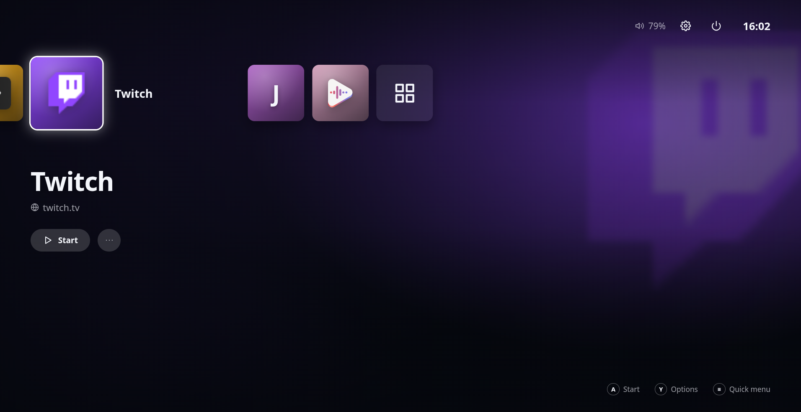
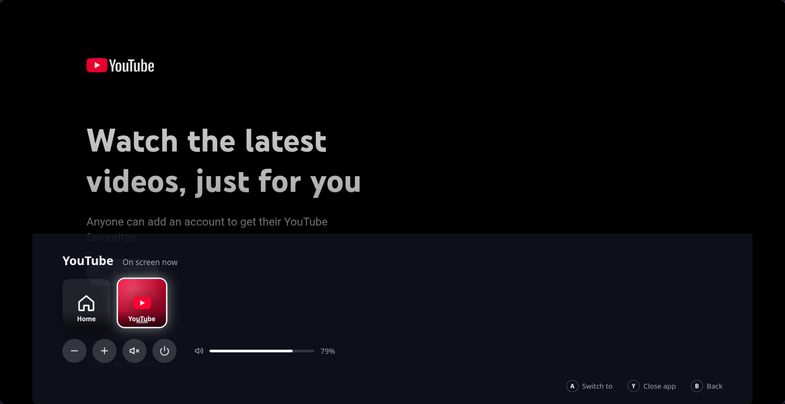
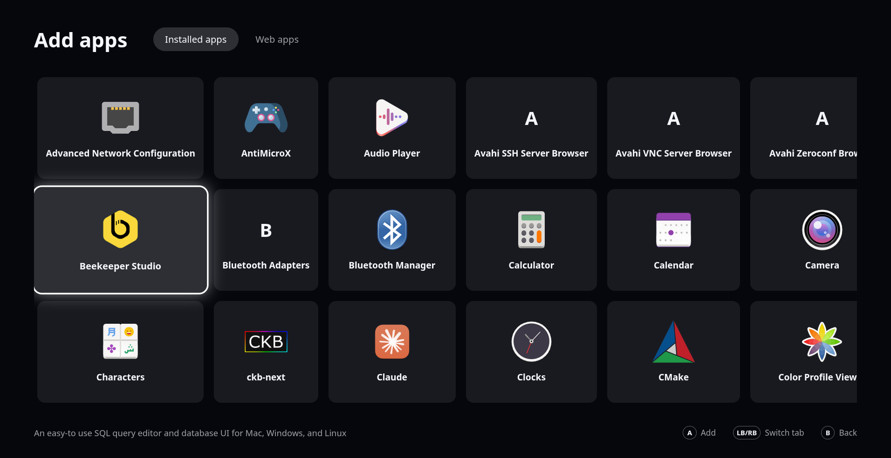
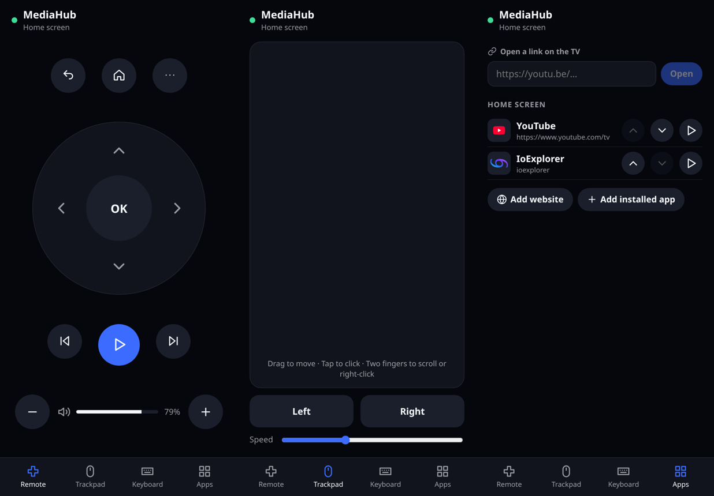

# MediaHub

A PS5-style home screen for the media server under your TV. It boots straight into gamescope, you drive it with a controller (or your phone), and every app opens fullscreen. Press the Guide button to hop back out, just like on a console.


<sup>The home screen. Whichever tile you're on paints the background with its colours.</sup>

## Key Features

- **Console-style home screen**: A row of big app tiles, a background that follows the focused app, menu sounds, and the familiar "A to start, Y for options" controls.
- **Apps and web apps**: Put installed apps on the home screen, or any website as its own fullscreen web app. YouTube gets its proper TV interface. Netflix and Disney+ open in Chromium, since they need DRM.
- **Instant switching**: Apps keep running in the background. Tap the Guide/PS button for the quick menu, where you can switch apps, close them, change the volume or turn things off. Hold it to jump straight home.
- **Your phone is the remote**: Open the hub's address on your phone for a D-pad remote, a laptop-style trackpad, and your phone's own keyboard for typing on the TV. No more pecking out passwords with a controller.
- **Open links on the TV**: Paste a link on your phone and it opens on the TV. YouTube links go straight into the TV app, a bit like casting.
- **Manage everything from the couch**: Add apps from the TV with the controller, or from your phone, where you can also rename them, change their links and upload your own tile art and backgrounds.
- **Wi-Fi from the sofa**: Settings → Network lists the Wi-Fi networks around you. Pick one and type the password with the on-screen keyboard (or a real keyboard, if you have one handy). Machines without Wi-Fi simply don't show it.
- **Set up in one go**: `setup.sh` installs everything, asks a few questions about your TV, and makes the machine boot into MediaHub. It works on Arch and Debian/Ubuntu.


<sup>The quick menu, opened over YouTube with a tap on the Guide button.</sup>


<sup>Adding apps from the TV. Web apps have their own tab, and anything else can be added from your phone.</sup>


<sup>The phone companion: remote, trackpad and the app manager.</sup>

## Setting up the TV box

You need a machine running **Arch Linux**, **Debian 13** or **Ubuntu 24.04+**, plugged into the TV, with a user account that can use `sudo`. Then, as that user:

```bash
git clone https://github.com/LucasionGS/mediahub.git
cd mediahub
./setup.sh
```

The script walks you through it and asks before every change it makes:

1. It installs gamescope, greetd, PipeWire and the build tools. On Debian it enables `trixie-backports` (contrib), where gamescope lives. Ubuntu 24.04 doesn't package gamescope at all, so there it builds gamescope from source into `/opt/gamescope` (along with the few newer libraries it needs, so your system's own copies stay untouched).
2. It builds MediaHub and installs it to `/opt/mediahub`.
3. It sets up controller access and the phone remote's virtual mouse and keyboard.
4. It asks which TV output, resolution and refresh rate to use, and whether to turn on VRR and HDR.
5. It picks the phone companion's port and opens it in ufw or firewalld.
6. If the machine has Wi-Fi but no NetworkManager, it offers to install NetworkManager just for Wi-Fi. Your wired network setup isn't touched.
7. It makes the machine log into MediaHub automatically at boot, through greetd.
8. It lets the hub shut down, restart, sleep and change Wi-Fi without a password prompt.

Run `./setup.sh` again any time to change your answers; it remembers the previous ones. Other commands:

- `./setup.sh update` pulls the latest version, rebuilds and reinstalls.
- `./setup.sh uninstall` removes MediaHub and puts your old greetd config back.
- `--yes` answers yes to everything, for unattended runs.

### Pairing your phone

Open **Settings → Phone remote** on the TV. It shows an address like `http://192.168.1.20:8420` and a 6-digit code. Open the address on your phone and enter the code. That phone stays paired until you unpair it in the same place.

## Controls

| Controller | Keyboard | What it does |
|---|---|---|
| D-pad / left stick | Arrow keys | Move around |
| A / Cross | Enter | Start or select |
| B / Circle | Escape | Back |
| Y / Triangle | O | Options for the focused app |
| LB / RB | Q / E | Switch tabs |
| Guide / PS (tap) | Shift+Escape (works inside apps too), F1 | Open or close the quick menu |
| Guide / PS (hold) | | Go home |

In web apps the D-pad and A/B buttons act as arrow keys, Enter and Escape, which TV-style sites like YouTube expect. Turn that off per app on your phone if a site has its own controller support.

## Technical details

<details>
<summary>How it works, and how to work on it</summary>

**Stack:** Electron + React + Vite + SCSS (Electron Forge, Node 24), plus a small Go helper (`native/input`) for evdev and uinput, which Node can't drive itself.

**Gamescope integration:** gamescope runs in Steam mode (`-e --xwayland-count 2`). The hub runs on the first Xwayland (`:0`) as appid 769, and apps run on the second.
- Every app is launched under a `reaper SteamLaunch AppId=<ID> --` parent process, the way Steam does it, which every gamescope version uses to work out a window's appid. The reaper is the Go helper started through a symlink.
- Each app also gets its own systemd scope (`app-steam-app<ID>-<n>.scope`), which the hub uses to stop the whole app. Set `MEDIAHUB_NO_SCOPE=1` on machines without a systemd user session.
- Switching apps means writing `GAMESCOPECTRL_BASELAYER_APPID` on the root window, with 769 always last so gamescope falls back to the hub.
- The quick menu is a second window with `STEAM_OVERLAY`. It's shown and hidden through `STEAM_INPUT_FOCUS` and its opacity.

**Data:** everything lives in `~/.mediahub`, or `$MEDIAHUB_DATA` when set:
- `apps.json` and `settings.json`;
- `artwork/` for tile art and backgrounds;
- `profiles/`, one browser profile per web app;
- `logs/`, holding each app's output from its last run and `session.log`;
- `session.conf`, the settings `setup.sh` writes.

**Development:**

```bash
npm install
npm run build:input   # the Go helper (needs Go)
npm start             # standalone mode, in a normal window on your desktop
gamescope -e --xwayland-count 2 -W 1920 -H 1080 -w 1920 -h 1080 -- npm start   # inside a nested gamescope
```

Standalone mode skips all gamescope calls, so you can work on the UI on a normal desktop. `npm run typecheck` and `npm run lint` check the code.

**Testing setup.sh:** `docker/` has Arch and Debian images that run a full setup, a second idempotent run and an uninstall:

```bash
docker build -f docker/Dockerfile.debian -t mediahub-test-debian . && docker run --rm mediahub-test-debian
```

**Known limitations:**
- Controller input isn't exclusive yet, so the app under the quick menu also sees D-pad presses.
- The phone keyboard types with a US layout, so letters like æ, ø and å don't come through.
- The companion runs over plain HTTP on your LAN, so it can't be installed as a PWA or used as a share target.

</details>
